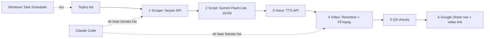

# Non-Coder Learning Plan: Claude se Video Factory banao, phir Claude ke bagair chalao

Ye plan tumhari 3 baaton par bana hai: tum **non-coder** ho, **Python** chahiye (n8n nahi),
aur goal hai **bulk + long videos** jo baad mein **Claude ke bagair** chalein.
Iske saath [`video-pipeline-guide.md`](video-pipeline-guide.md) (technical architecture) padho.

> **Verification legend** (videos ke saath):
> ✅ = maine video ka metadata (title/channel/length) check kiya, chat se match hua.
> 🔎 = YouTube search result mein title/channel/length dikhi, page ka detail check nahi kiya.
> ⚠️ = sirf Genspark chat mein hai, maine verify **nahi** kiya.
> ❌ = link kharab hai.
> NexLev ki weekly limit khatam ho gayi, isliye baaki links verify nahi ho sake.

---

## 0. Poori tasveer



- **Claude Code** = tools **banata** hai (ek baar, phir upgrades).
- **Task Scheduler + Python + APIs** = tools **chalata** hai (roz, Claude ke bagair).

---

## 1. Genspark chat ka analysis

**Achi baatein:** stages ka split sahi hai (scrape → script → render → orchestrate → sheet);
n8n ki jagah Python (tumhari demand); cost ka andaza; Hindi/Urdu videos ki koshish;
videos asli hain (sample check: 5/5 ka title aur channel match hua).

**Masle** (severity ke saath):

| # | Masla | Ye kyun matter karta hai | Evidence |
|---|---|---|---|
| 1 | 🔴 **"Video" sirf placeholder hai** | Render stage 3 second ka solid-color 1080x1920 clip banata hai jis par ek text line hai. Na voice, na visuals, na music, na captions. Tumhara goal long, "perfect" videos hain. | `render.py` (`color=c=0x1e293b ... d=3` + `drawtext`) |
| 2 | 🔴 **TTS ka koi stage nahi** | Voiceover ke bagair content video nahi banti. Chat mein TTS ki ek bhi video nahi. | Poori chat mein "TTS" nahi |
| 3 | 🔴 **"E2E test pass" bhrmaak hai** | `DRY_RUN=true` mein scrape skip, LLM canned JSON, render "would render", Sheet "would upload". Sirf imports/wiring test hui, koi asli API ya ffmpeg call nahi. Dry-run mein `video_path` aisi file ka path banta hai jo bani hi nahi, phir bhi status `"done"` aata hai. | Chat ke log: `[DRY_RUN] would render`, `would upload` |
| 4 | 🟠 **Remotion nikal diya** | Tum ne Remotion maanga tha, chat ne bola "Python build mein nahi hai" aur chhod diya. Quality wali videos isi se aati hain. | Chat ka akhri note |
| 5 | 🟠 **Gemini ko system prompt nahi jata** | `_gemini_generate` sirf `contents=prompt` bhejta hai; `SCRIPT_SYSTEM` ("STRICT JSON only") sirf OpenRouter path mein use hota hai. Default backend par JSON bigadne ke chances zyada. Structured-output (schema) bhi use nahi hua, regex se JSON nikalte hain. | `script_gen.py` |
| 6 | 🟠 **Koi state/resume/dedup nahi** | Dobara chalao to same topics dobara scrape, dobara paise, Sheet mein duplicate rows. Daemon har weekday wahi 3 fixed topics chalata hai, yani baar baar same content. | `orchestrator.py`, `daemon.py` |
| 7 | 🟠 **Failure chup-chaap dab jati hai** | Galat Serper key ho to error log hota hai, saare topics skip, aur akhir mein `pipeline complete \| 0 rows`. Retry har error par 4 baar, galat API key par bhi. | `scrape.py`, `common.py` |
| 8 | 🟡 **Windows/Urdu-Hindi text ka risk** | `drawtext` bina `fontfile` ke Windows par aksar font nahi dhoondta; Urdu/Hindi shaping ffmpeg build par depend karti hai. **Ye code padh kar likha hai, chala kar nahi** (is machine par ffmpeg nahi hai). | `render.py` |
| 9 | 🟡 **Pricing/model "verified" claims kamzor** | Sources benchlm.ai/cloudzero hain, Google ka pricing page nahi. Default `gemini-2.5-flash-lite` ab purana ho sakta hai (nayi Gemini 3.x family ki khabrein hain). Model `.env` mein hai, ye achha hai. | Chat ka table |
| 10 | 🟡 **Sheet mein local path** | `video_path` tumhare PC ka path hai, kisi ko kaam nahi. Video Drive/YouTube par upload nahi hoti. "Sheet mein upload" ka matlab clarify karna hai. | `sheet_upload.py` |
| 11 | 🟡 **Learning path non-coder ke liye bhaari** | 77 links, aur Python course/cron videos. Non-coder ko Python seekhne ki zaroorat nahi; usay Claude Code ko sahi instruct karna aur output check karna aana chahiye. | Chat ka Step 5 |
| 12 | 🟡 **"Claude-free" ka proof `grep` se** | Code mein "claude" lafz na hona proof nahi hai. Claude-free ka matlab hai runtime par koi agent session na ho. Ye architecture ki cheez hai. | `grep -riE "n8n\|claude"` step |

**Ek link kharab:** ❌ `kXnZy7LYlM` ("gspread in 5 minutes") mein 10 characters hain, YouTube ID 11 ke hote hain.

**Do nam jo shayad sahi guess hue:** "surper dev" = **Serper.dev**, "openlux" = **OpenRouter**. Chat ne inko
"unconfirmed" chhoda tha, mera bhi yehi andaza hai. Tum confirm kar dena.

**Nateeja:** chat ne "factory ka dhancha" diya, lekin **factory ka asli kaam (voice + visuals + quality
video) nahi banaya**. Isliye is zip ko base mat banao. Naya, contracts-first pipeline Claude Code se
banwao (section 4).

---

## 2. Kaise seekhna hai (rules)

1. **Coding nahi seekhni.** 3 skills seekhni hain: (a) Claude Code ko sahi instruct karna, (b) apni Windows machine par cheezein chalana (install, `.env`, run, error paste), (c) **output check karna**: video dekho, audio suno, Sheet kholo.
2. **Kam dekho, zyada banao.** Har phase: 1–2 video 1.25x par dekho, phir turant Claude Code se chhota kaam banwao.
3. **Ek phase, ek "done when" check.** Pass na ho to agle phase par mat jao.
4. **Pehle ek chhota poora slice:** 1 topic → 1 script → 1 voice → 1 chhoti video → 1 Sheet row. Jab ye chal jaye tab bulk aur long video.
5. **Har file ka explain maango:** "Ye file kya karti hai, 3 line Roman Urdu mein." `NOTES.md` mein jama karo.
6. **Error aaye to:** red text copy karo, Claude Code ko do: "Ye error aaya. Pehle root cause batao, fix karo, phir khud run karke dikhao."
7. **API keys kabhi chat mein paste mat karo.** Sirf `.env` file mein.
8. **Test hamesha 1 topic par**, bulk baad mein (paise bachte hain).

Andaza: rozana 1–2 ghante par ~5–6 hafte mein pehla poora slice; long-form aur polish us ke baad.

---

## 3. Phase-by-phase plan

### Phase 0 — Setup (1 din)
**Karna:** Claude Code (desktop app ya terminal), VS Code, Python 3.12, Node 20+, Git, FFmpeg install.
**Done when:** `python --version`, `node -v`, `ffmpeg -version` teenon chalte hain.

| Video | Language | Status |
|---|---|---|
| Full Claude Code Tutorial for Non-Technical Beginners (Futurepedia, 41 min): Plan Mode, CLAUDE.md, API key jodna, GitHub, deploy | English | ✅ https://www.youtube.com/watch?v=bqJzIWAEn40 |
| Claude Code Complete Course in Hindi (Kamran AI Insights, 5.4 ghante). **Sirf Class 1–2 dekho (0:00–1:52:20):** install, Windows setup, VS Code, modes, CLAUDE.md | Hindi | ✅ https://www.youtube.com/watch?v=TIKReAs7yGE |
| How to Install FFmpeg on Windows, Hindi (Manish Tech Zone, 4:43) | Hindi | 🔎 https://www.youtube.com/watch?v=7iVt2k9-XAA |
| Claude Code Tutorial in Hindi, Day 1 (AI Learners India, 30 min) | Hindi | 🔎 https://www.youtube.com/watch?v=FyS3pt2kiK4 |

### Phase 1 — Claude ko instruct karna (2–3 din)
**Karna:** Plan Mode, `CLAUDE.md`, chhote tasks, error paste karna.
**Done when:** Claude Code se ek chhota tool (jaise "folder ki files ke naam list karo") banwa kar chalaya.

| Video | Language | Status |
|---|---|---|
| Claude AI Full Course 2026 (Anyoneskill, 5.7 ghante). **Chapters:** "Claude for Coding" 1:45:00, "Claude for Automation Workflows" 3:58:00 | Hindi | ✅ https://www.youtube.com/watch?v=FsuaCYjMZK4 |
| Master 85% Claude AI in 23 min (HBA Services) | Urdu/Hindi | 🔎 https://www.youtube.com/watch?v=EIlKrufU5ac |
| Claude Code Complete Tutorial (Ayushman Pandita, 23 min) | Hindi/Hinglish (title English, confirm karo) | 🔎 https://www.youtube.com/watch?v=HPAE3En9Gvs |

### Phase 2 — FFmpeg samajhna (2 din)
**Karna:** ffmpeg kya hai, trim, concat (jodna), audio nikalna, duration nikalna.
**Done when:** 2 chhote clips ko jodkar ek mp4 banayi, aur ek mp4 se mp3 nikali.

| Video | Language | Status |
|---|---|---|
| FFmpeg Tutorial for Beginners, Step-by-Step Guide Hindi (12:45) | Hindi | 🔎 https://www.youtube.com/watch?v=Bylelg6uhFU |
| आपको अभी FFmpeg सीखने की जरूरत है (DevOps Toolbox, 12:40, 3.3 lakh views) | Hindi title | 🔎 https://www.youtube.com/watch?v=6uB65PdasQI |
| FFmpeg Concatenate: merge videos without re-encoding (6:26). Long video ke segments jodne ke liye kaam ki | English | 🔎 https://www.youtube.com/watch?v=KJ7Mb1TIHiE |
| FFmpeg Part 1 in Hindi: streams, containers, bitrate, codecs (30:57) | Hindi | 🔎 https://www.youtube.com/watch?v=84dNQgzMVNE |

### Phase 3 — Scrape + Script (Serper + Gemini) (3–4 din)
**Karna:** Serper API key, Gemini API key (Google AI Studio), `.env`, JSON script.
**Done when:** 1 topic se `jobs/<slug>/script.json` bana jo schema se validate hota hai, 10 topics par 10/10 valid.
**Model:** current Gemini Flash-Lite model ka naam Google AI Studio ke model list se lo, `.env` mein `GEMINI_MODEL` rakho.

| Video | Language | Status |
|---|---|---|
| Ultimate Web Scraping tutorial (CodeWithHarry, 41 min). Sirf concept: HTML/requests kya hote hain | Hindi | ✅ https://www.youtube.com/watch?v=1227R6KY8Ts |
| Gemini API Tutorial: End-to-End (Developer Coding) | Hindi | ⚠️ https://www.youtube.com/watch?v=ltN1pX9oWR0 |
| Gemini API with Python: Getting Started (Patrick Loeber) | English | ⚠️ https://www.youtube.com/watch?v=qfWpPEgea2A |

### Phase 4 — Voice (TTS) (3 din)
**Karna:** Gemini TTS ya koi aur TTS. **Sabse pehle Urdu/Hindi awaaz khud sun kar provider chuno.**
**Done when:** 10 line ki narration ki wav bani aur tumhe awaaz pasand aayi.
**Video:** chat mein ya meri search mein koi TTS video nahi mili. Google AI Studio ka **Speech Playground** khol kar apni Urdu/Hindi line paste karo aur suno; ye sabse behtareen "tutorial" hai. YouTube par search karo: `Gemini TTS API Python`.

### Phase 5 — Remotion (visuals) (5–7 din)
**Karna:** scene templates (title, bullets, stat, quote), voice ki lambai se scene ki duration, ek 60 sec ki video render.
**Done when:** `props.json` se 60 sec ki video bani jis mein voice + text + motion hai, aur tum ne render ka time note kiya.

| Video | Language | Status |
|---|---|---|
| Remotion: Complete Tutorial for Beginners (Matt Penny) | English | ⚠️ https://www.youtube.com/watch?v=0-Uw6O52wI4 |
| Remotion: Motion Graphics with AI (official) | English | ⚠️ https://www.youtube.com/watch?v=5NRAOnKc3c8 |
| Create Motion Graphics with AI, Claude + Remotion (Zinho Automates) | English | ⚠️ https://www.youtube.com/watch?v=MAhkbZHcbLA |

Remotion ki Hindi video mujhe verify hoti nahi mili. YouTube par exact titles dhoondo:
`Your Videos Don't Have to Look Amateur Anymore (Claude + Remotion)` aur
`How I Vibe Code Technical Videos With Claude Code and Remotion` (ye chat ki search mein aaye the).

### Phase 6 — Sheet + QA (2–3 din)
**Karna:** Google service account, Sheet share karna, ek row upload, video ka shareable link.
**Done when:** Sheet mein row aai jis mein video ka **link** hai (local path nahi).

| Video | Language | Status |
|---|---|---|
| Automate Google Sheets with Python (Tech With Tim) | English | ⚠️ https://www.youtube.com/watch?v=zCEJurLGFRk |
| Google Sheets automation with Python (Accidental Software Tester) | Hindi | ⚠️ https://www.youtube.com/watch?v=OzscY5uDeK0 |
| ~~gspread in 5 minutes~~ | | ❌ link kharab, chhod do |

### Phase 7 — Long video + Bulk (1–2 hafte)
**Karna:** 1–3 minute ke segments render karke jodna, cache, resume, 10 topics ki queue.
**Done when:** 10 minute ki video bani, ek scene badla to sirf ek segment dobara render hua.
Technical detail: [`video-pipeline-guide.md`](video-pipeline-guide.md) section 3.1.

### Phase 8 — Claude ke bagair chalao (2 din)
**Karna:** Windows Task Scheduler (section 5).
**Done when:** Claude band karke bhi roz raat ko job chali aur `logs/` mein result mila, 3 din lagatar.

| Video | Language | Status |
|---|---|---|
| Schedule Python Scripts in Windows (Vincent Stevenson) | English | ⚠️ https://www.youtube.com/watch?v=ic4lUiDTbVI |
| Run Python Script with Windows Task Scheduler (Coding Under Pressure) | English | ⚠️ https://www.youtube.com/watch?v=4n2fC97MNac |

---

## 4. Claude Code ke copy-paste prompts

Har prompt Plan Mode mein chalao: pehle plan dikhao, tum approve karo, phir banao.

**P1 — Phase 3 (pehla prompt):**

```text
Main non-coder hoon. Roman Urdu mein simple samjhao, jargon nahi.
Goal: Windows par chalne wala "video factory" tool, jo aakhir mein Claude ke bagair chale.
Abhi sirf STEP 1 banao (video nahi):
1. Folder `video-factory`, Python 3.12 venv.
2. `topics.txt` se ek topic lo (har line ek topic).
3. Serper API se top-10 Google results (title+snippet) lo, `jobs/<slug>/research.json` mein save karo.
4. Gemini API se research bhej kar STRUCTURED JSON script mangao (title, hook, 8-12 scenes, har scene ki narration).
   JSON schema se validate karo, invalid ho to sirf 2 dafa retry.
5. Result `jobs/<slug>/script.json` mein save karo.
Rules: keys sirf `.env` mein (`.env` git mein na jaye); model naam `GEMINI_MODEL` se, hard-code nahi;
galat API key par retry mat karo balki saaf Roman Urdu error do; har step `logs/` mein log kare;
agar koi step fail ho to process non-zero exit code de, chup na ho.
Pehle plan dikhao. Banane ke baad khud run karke output dikhao, aur README mein "kaise chalayein" 5 line mein likho.
```

**P2 — Phase 4 (voice):**

```text
`script.json` ki har scene narration ki alag wav file banao `jobs/<slug>/audio/s001.wav`...
TTS provider ek interface ke peeche rakho taake baad mein badal sako. Provider aur voice `.env`/config se.
Same text dobara ho to cache se lo (API call nahi). Har wav ki duration ffprobe se nikal kar `props.json` mein likho.
Chhoti test: sirf pehle 3 scenes par chalao aur mujhe files ke naam aur durations dikhao.
```

**P3 — Phase 5 (Remotion):**

```text
Remotion project banao. `props.json` se video render ho. 4 scene types: title, bullets, stat, quote.
Har scene ki duration uski audio ki lambai se aaye. Ek hi design system: 2 fonts, 4 colors, safe margins.
Pehle 60 second ka test render karo aur bataao kitna time laga.
```

**P4 — Phase 7 (long video):**

```text
Video ko chapters (1-3 min) mein render karo, phir ffmpeg se jodo. Har segment ka cache key ho
(scene props + template version). Script mein ek line badle to sirf wahi segment dobara render ho.
Job kill hone ke baad dobara chalao to wahin se resume ho.
```

**P5 — Phase 8:**

```text
`run.bat` banao jo venv activate kare aur pipeline chalaye, output `logs\task.log` mein append kare.
FFmpeg ka poora path `.env` mein rakho. Ek `--dry-run` aur ek `--topic` option rakho.
Fail par `logs\failed.txt` mein likho. Phir mujhe Windows Task Scheduler ke exact steps batao.
```

---

## 5. Windows Task Scheduler: roz automatically chalane ke steps

**Pehle `run.bat` banao** (project folder mein):

```bat
@echo off
cd /d C:\video-factory
call .venv\Scripts\activate.bat
python -m pipeline.run --queue >> logs\task.log 2>&1
```

Phir:

1. Start menu mein **Task Scheduler** kholo.
2. Right side par **Create Task** (Basic Task nahi, isme zyada options hain).
3. **General:** naam `VideoFactory`; **"Run whether user is logged on or not"** chuno.
4. **Triggers → New:** Daily, time chuno (jaise 02:00).
5. **Actions → New:** Start a program.
   - Program/script: `C:\video-factory\run.bat`
   - **Start in:** `C:\video-factory` (ye zaroor bharo, warna paths tootte hain)
6. **Conditions:** agar laptop hai to "Start only if on AC power" band karo; "Wake the computer to run this task" chahiye to on karo.
7. **Settings:** "Run task as soon as possible after a scheduled start is missed" on karo; "If the task fails, restart every" 10 min, 3 baar.
8. OK dabao, Windows password maangega.
9. Task par right-click → **Run** se abhi test karo, phir `logs\task.log` kholo.

**Aam masle:**
- Task chalta hai par kuch nahi hota → `logs\task.log` dekho; aksar paths ya `.env` ka masla.
- `ffmpeg` not found → Task Scheduler ka PATH alag hota hai, `.env` mein poora path do.
- PC band ho to task nahi chalta; raat ko PC on rakho ya VPS lo.

Screenshots main yahan nahi bana sakta. Video ⚠️ `ic4lUiDTbVI` mein ye screens dikhte hain.

---

## 6. Risk

- YouTube ki "inauthentic/repetitive content" policy mass-produced template videos ko monetization se roak sakti hai **[VERIFY]**. Har video mein alag angle/research/value rakho.
- Publish se pehle 2 minute ka human review rakho.
- Remotion license: chat ke mutabiq chhoti teams free, badi companies ko paid **[VERIFY: remotion.dev/docs/license]**.

## 7. Mujhe tumse chahiye

1. Video **language** (Urdu/Hindi/English) aur **niche**?
2. **Sheet mein upload** ka matlab: sirf data row, ya video bhi (Drive/YouTube)?
3. "Surper dev" = Serper.dev aur "openlux" = OpenRouter, sahi?
4. Tumhara PC: Windows? RAM/CPU? Roz PC on rehta hai?
5. Target: roz kitni video, aur kitni lambi?
